# Legacy System Migration to AWS: WordPress on EC2

Migrating a company's legacy web application to AWS. The target environment is provisioned with Terraform, the LAMP stack (Linux, Apache, MySQL, PHP) is built by hand on an Ubuntu EC2 instance, and WordPress is deployed as the site platform. The project ends with a database dump and restore test that simulates moving existing data onto the new server.

Migration strategy: **Rehost** ("lift and shift"). The application moves to cloud infrastructure with its architecture unchanged.

## Architecture

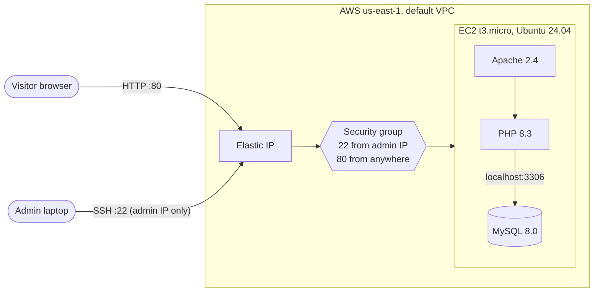

## Tech stack

| Layer | Tool |
|---|---|
| Infrastructure as code | Terraform (AWS provider 6.x) |
| Compute | EC2 t3.micro, Ubuntu Server 24.04 LTS, encrypted gp3 volume |
| Networking | Default VPC, security group, Elastic IP |
| Web server | Apache 2.4 |
| Language runtime | PHP 8.3 |
| Database | MySQL 8.0 |
| Application | WordPress |

## Repository contents

```
.
├── providers.tf               # Terraform and AWS provider versions
├── variables.tf               # region, instance type, admin IP
├── main.tf                    # key pair, security group and rules, AMI lookup, EC2, Elastic IP
├── outputs.tf                 # public IP, SSH command, site URL
├── terraform.tfvars.example   # copy to terraform.tfvars and add your IP
├── .terraform.lock.hcl        # pinned provider versions
└── docs/screenshots/          # build evidence, numbered in order
```

## Deploying the infrastructure

Requirements: Terraform 1.5+, AWS CLI configured with credentials, and an SSH client.

```powershell
# 1. Create an SSH key pair locally (the private key never leaves your machine)
ssh-keygen -t ed25519 -f "$HOME\.ssh\wordpress-migration-key" -C "wordpress-migration"

# 2. Add your public IP
copy terraform.tfvars.example terraform.tfvars   # then edit my_ip

# 3. Provision
terraform init
terraform plan
terraform apply

# 4. Connect
terraform output -raw ssh_command
```

The server configuration below was done manually over SSH so each component could be learned step by step.

## Build walkthrough

### 1. Provision with Terraform

Terraform creates 7 resources: the key pair, security group, three security group rules, the instance, and an Elastic IP. The AMI is looked up with a `data` block filtered to Canonical's account, so it always resolves to the current Ubuntu 24.04 image.

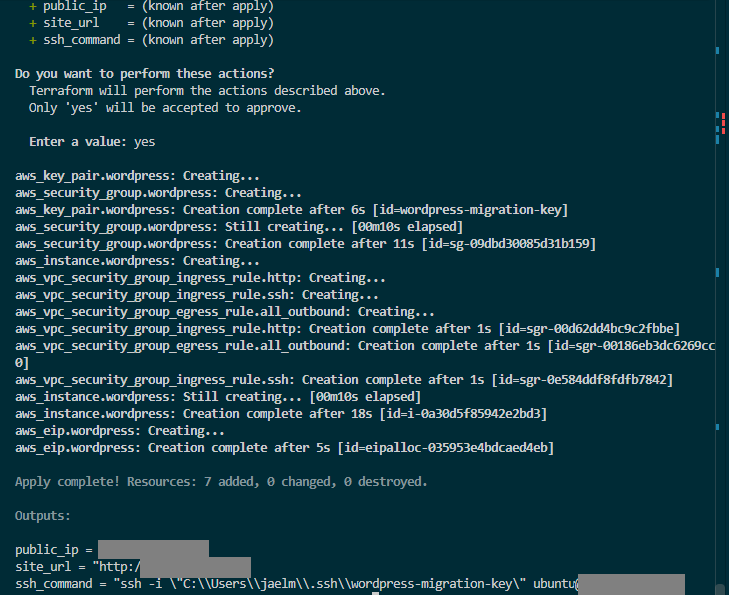
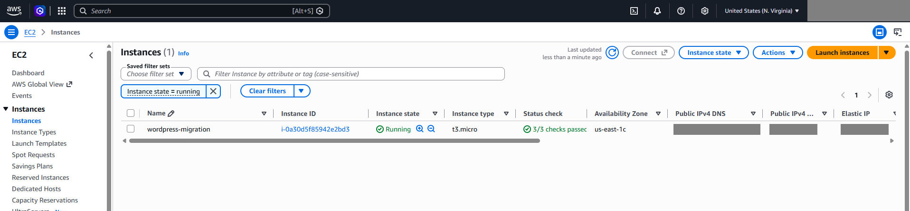

### 2. Connect and update

SSH in, then `apt update && apt upgrade`. The instance only sees its private VPC address; AWS translates the Elastic IP at the internet gateway.

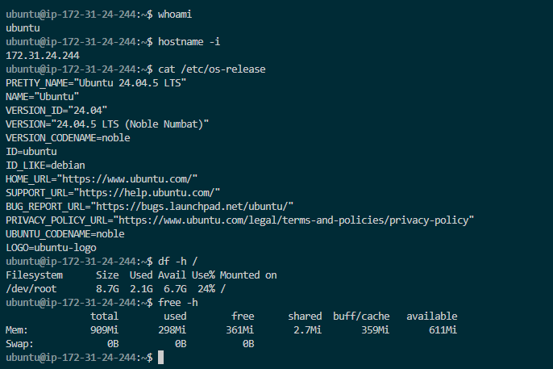

### 3. Install the LAMP stack

Apache, PHP with the extensions WordPress expects, and MySQL. A 1 GB swap file was added because the instance has under 1 GB of RAM and MySQL alone uses several hundred MB.

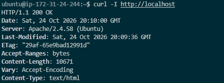
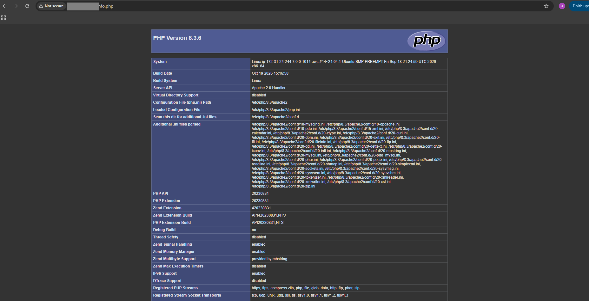
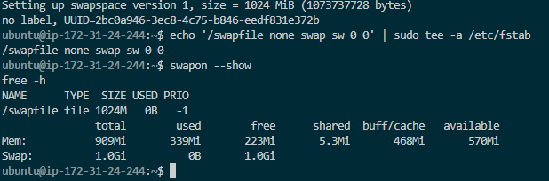
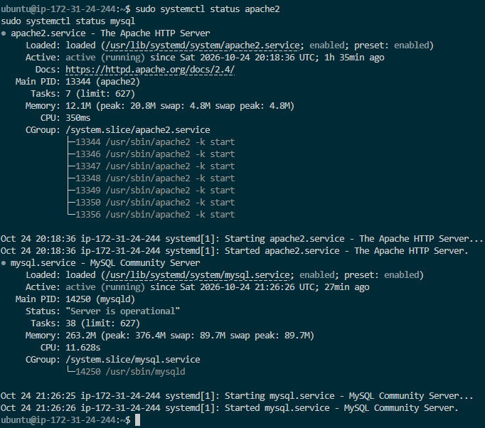

### 4. Deploy WordPress files

The download was verified against WordPress.org's published SHA-1 checksum before extraction. Files were moved to `/var/www/html` and ownership given to `www-data`, the user Apache runs as.


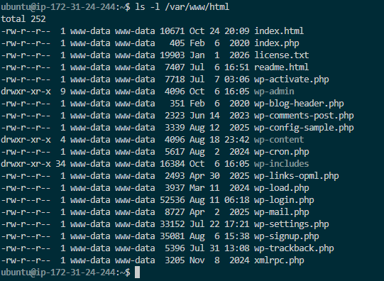

### 5. Database and least-privilege user

A dedicated `wordpress_user` with access to `wordpress_db` only. Logged in as that user, the `mysql` and `sys` system databases are not visible.

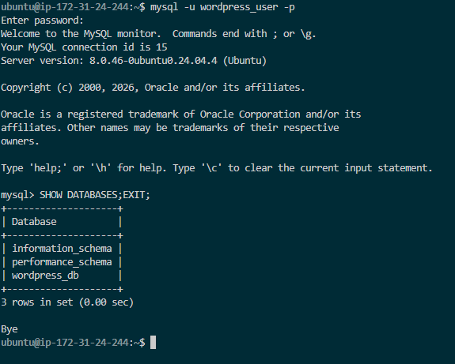

### 6. Configure and install

`wp-config.php` was set with the database credentials and freshly generated security keys, then locked to `640`. After the installer ran, WordPress created its 12 tables.

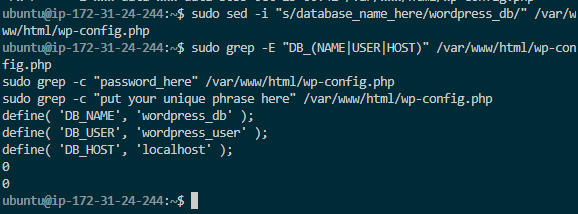
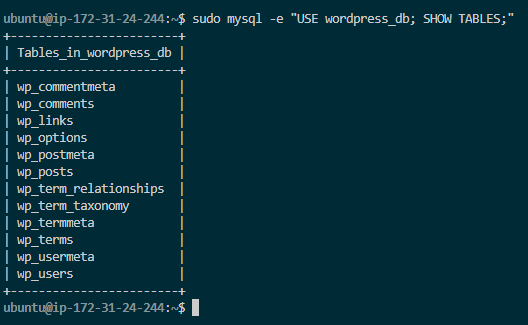
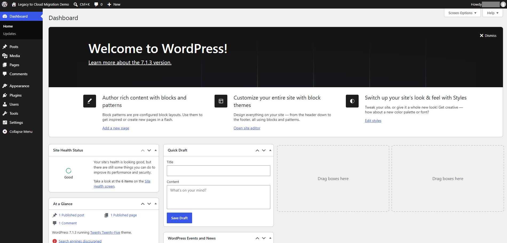

### 7. Hardening review

Site Health started with 6 recommendations. Inactive plugins and themes were removed and the missing `imagick` module installed, leaving 3 items that are intentional or listed under future improvements.

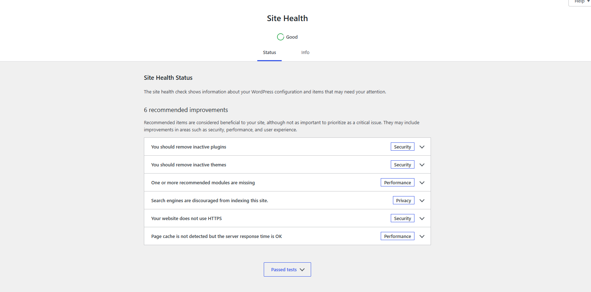
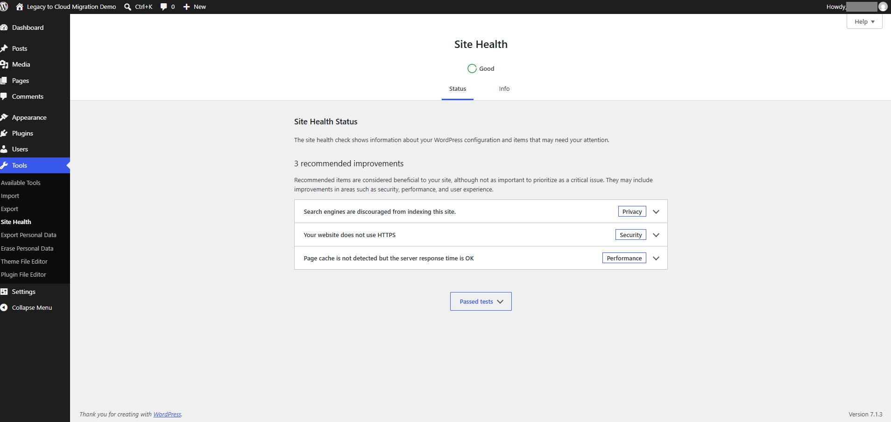

### 8. Bonus: data dump and load

This simulates the core of a real migration: exporting data from one database and loading it into another.

1. Published a test post, then exported with `mysqldump --single-transaction`.
2. Dropped `wordpress_db` and confirmed the site broke.
3. Recreated the empty database. WordPress redirected to its installer because it found no tables.
4. Loaded the dump with `mysql wordpress_db < backup.sql`.
5. Confirmed all 12 tables, the test post, and the admin login were restored.

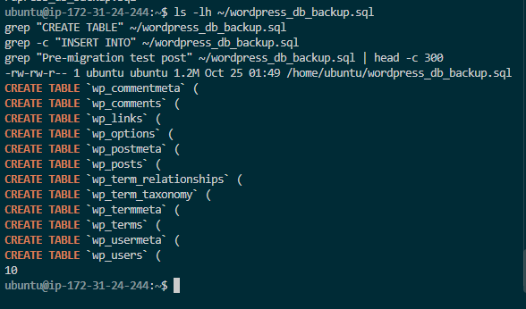
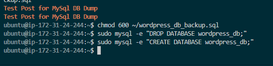
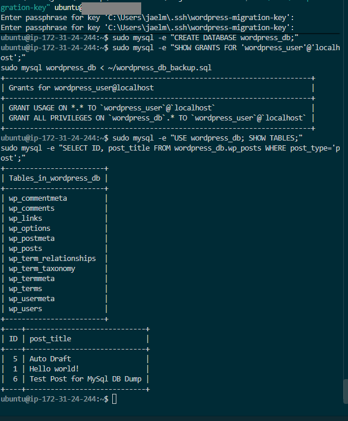

## Troubleshooting log

| Symptom | Cause | Fix |
|---|---|---|
| `terraform plan` prompted for `var.my_ip` | `terraform.tfvars` not found | Created the file in the project root |
| Plan showed 4 resources instead of 5 | Key pair block missing from `main.tf` | Added and saved the block |
| `ERROR 1819` on `CREATE USER` | Placeholder password failed the MEDIUM policy | Used a compliant password |
| `ERROR 1410` on `GRANT` | User didn't exist, and MySQL 8 no longer creates users through `GRANT` | Created the user first |
| HTTP 500, "Database Error" page | `DB_PASSWORD` in `wp-config.php` didn't match MySQL | Corrected the password |
| `ERR_TOO_MANY_REDIRECTS` during restore test | Empty database means WordPress can't read its site URL and builds the installer redirect from the current path | Expected; cleared once the dump was loaded |

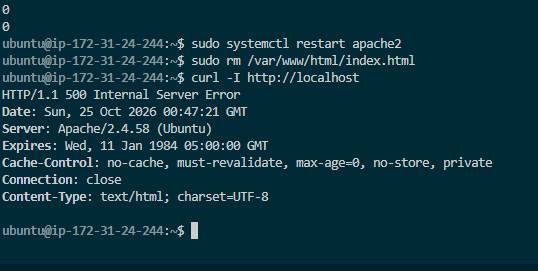
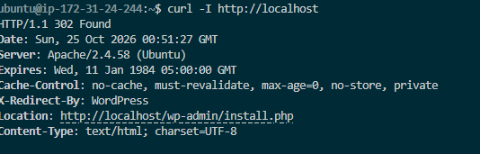

## Security notes

- No secrets are committed. `.gitignore` excludes state files, `*.tfvars`, keys, and SQL dumps.
- The SSH private key was generated locally; only the public key was uploaded.
- MySQL listens on `127.0.0.1` only, and the security group has no rule for 3306.
- WordPress admin uses a non-default username and a unique password.
- IPs, account details, and usernames are redacted in screenshots.

## Future improvements

- **HTTPS** with a domain name and a Let's Encrypt certificate
- **Database separation:** move MySQL to RDS in a private subnet
- **Off-server backups:** nightly `mysqldump` to a versioned S3 bucket (3-2-1 rule)
- **Configuration as code:** automate the server build with `user_data` or Ansible
- **Remote Terraform state** in S3 with locking
- **Monitoring** with CloudWatch alarms for CPU, memory, and disk

## Cleanup

```powershell
terraform destroy
```

Removes all 7 resources, including the Elastic IP, so nothing keeps billing.
